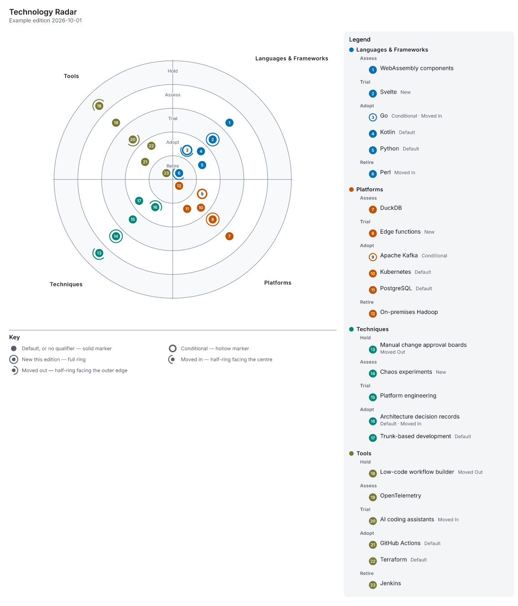

---
tags:
  - reference
  - examples
aliases: []
doc_id: RG-106
doc_name: README
crumb_id:
document_title: "Examples"
created_date: 2026-10-23
synopsis: "A worked radargen example: a CSV following the intake and maturation process, the config that renders it, a palette to try, and the outputs in every format."
status: active
type: Reference
revision: "1.0"
review_date:
reviewed_by: []
completed_date:
comments: "The outputs are regenerated with just examples; tests/examples.rs fails when they drift."
---

# Examples



An example edition of a radar kept as the [intake and maturation process](../process.md) describes. Every file here is real input or real output: run the commands below from the repository root to make them yourself.

| File | What it is |
| --- | --- |
| [`radar.csv`](radar.csv) | The register: every column radargen reads, all five rings, Default and Conditional items, movement since the last edition, retirement and review dates, and rows in the register-only states (Candidate, In Use, Rejected, Retired, Archived). An extra `owner` column is kept in the register and published only with `--table all`. |
| [`radar.toml`](radar.toml) | The config: title, a dated subtitle, the five rings outermost first, the register-only states as unplotted rings, and shaded rings. |
| [`palette.slate.css`](palette.slate.css) | A palette to try: a light cool-grey ground with blue accents (see the [palette guide](../palette.md)). |
| [`radar.html`](radar.html) | The interactive page: hover or tab to an item for its details, switch the theme, open the table. |
| [`radar.png`](radar.png), [`radar.svg`](radar.svg), [`radar.pdf`](radar.pdf) | The same edition as an image, a vector drawing and a tagged PDF. |

## Making them

```sh
radargen -c docs/examples/radar.toml                         # radar.html, the config's output
radargen -c docs/examples/radar.toml -o radar.pdf            # any other format
radargen -c docs/examples/radar.toml -o slate.png -p docs/examples/palette.slate.css
radargen -c docs/examples/radar.toml -o edition.pdf --pdf full --table all
```

A path in the config is read from the config's folder, so the first command writes `docs/examples/radar.html` wherever you run it; a path on the command line is read from where you are.

`just examples` rewrites the four outputs here, and `cargo test --test examples` fails when they no longer match what radargen makes.

## Revisions

| Revision | Date | Notes |
| --- | --- | --- |
| 1.0 | 2026-10-23 | Initial version. |
