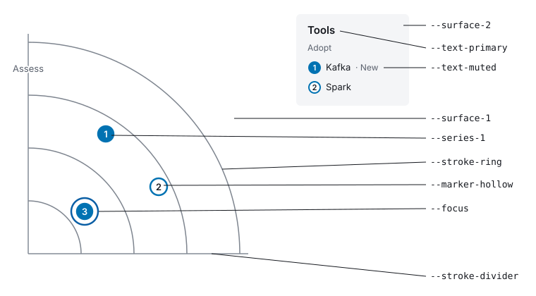

---
tags:
  - guide
  - palette
aliases: []
doc_id: RG-101
doc_name: palette
crumb_id: rg-cdo
document_title: "Palettes"
created_date: 2026-10-17
synopsis: "How to draw a radar in your own colours with --palette: what the file holds, where each of its colours is drawn, the contrast each needs, and how the quadrant colours cycle."
status: active
type: Guide
revision: "1.0"
review_date:
reviewed_by: []
completed_date:
comments: "Written for PR 18 (rg-cdo), from PRD FR-81, FR-82, FR-86, FR-87, FR-102 and SC-20."
---
# Palettes

`--palette <file.css>` draws a radar in your colours instead of radargen's built-in themes, in every format. Start from [`docs/product/palette.sample.css`](product/palette.sample.css), which holds the built-in light colours.

## The file

The file is exactly one `:root` rule of CSS custom properties, each a `#RRGGBB` colour, in any case. Comments are allowed anywhere. Anything else is an error that names its line: another rule (such as `[data-theme="dark"]` or `@media`), a property radargen does not know, a property declared twice, or a value such as `rgb(0 114 178)`, `#06C` or `red`. Every problem in the file is reported in one run, and nothing is drawn until the file is fixed.

A palette is one set of colours, so `--palette` cannot be combined with `--theme`. An HTML page drawn with a palette has no theme button and does not follow the reader's light or dark setting, so readers who rely on dark mode do not get it there. Windows high-contrast mode still replaces its neutral colours.

## The colours

A contrast ratio says how far apart two colours are in lightness, from 1:1 (the same) to 21:1 (black on white). Any checker that takes two hex values will compute it, [WebAIM's](https://webaim.org/resources/contrastchecker/) for one.

| Property | Where it is drawn | Light | Dark | Minimum contrast against |
| --- | --- | --- | --- | --- |
| `--surface-1` | The page and the radar's ground; the halo behind ring labels; the thin outline around solid markers; a selected table row | `#FFFFFF` | `#15181D` | — |
| `--surface-2` | The legend, the detail panel, the table, and the page's buttons | `#F4F5F7` | `#1E222A` | — |
| `--text-primary` | Names, headings, table text and links, and the number in a hollow marker | `#16191F` | `#E8EAEE` | 4.5:1 against `--surface-1`, `--surface-2` and `--marker-hollow` |
| `--text-muted` | Ring labels, the subtitle, legend ring headings, the key, column headings, and an item's details | `#585F6B` | `#A6AEBB` | 4.5:1 against `--surface-1` and `--surface-2` |
| `--stroke-ring` | Ring circles | `#7E858F` | `#6C7480` | 3:1 against `--surface-1` and `--surface-2` |
| `--stroke-divider` | Quadrant dividers, the line above the key, table rules, and panel and button borders | `#848B96` | `#666E7A` | 3:1 against `--surface-1` and `--surface-2` |
| `--marker-hollow` | Inside a hollow marker or legend badge; usually the same as `--surface-1` | `#FFFFFF` | `#15181D` | — |
| `--focus` | The keyboard focus ring, and focus outlines on buttons, links and the table toggle | `#0B5FA5` | `#7FB8E6` | 3:1 against `--surface-1` and `--surface-2` |
| `--series-1` onward | Each quadrant's markers and legend badges | see below | the same | 3:1 against `--surface-1` and `--surface-2`, and 4.5:1 against white or `#16191F` |

All eight roles are required. The dark column is the built-in dark theme: the sample file gives each value in a comment beside its light one, so swapping them all in gives a dark palette.

## Quadrant colours

`--series-1`, `--series-2` and on colour the quadrants in their sorted order. With more quadrants than entries, the colours start again from `--series-1`. Number them from 1 with no gaps; there can be as few as one or as many as you like. The built-in eight are:

| Entry | Colour |
| --- | --- |
| `--series-1` | `#0072B2` blue |
| `--series-2` | `#C25400` vermillion |
| `--series-3` | `#00857A` teal |
| `--series-4` | `#787832` olive |
| `--series-5` | `#B5476B` rose |
| `--series-6` | `#2F9626` green |
| `--series-7` | `#C431B8` magenta |
| `--series-8` | `#9D5A43` terracotta |

They are ordered most distinct first, so a radar with three quadrants uses the three easiest to tell apart, for normal and colour-deficient vision alike. Keep your most distinct colours first too. Quadrants never depend on colour alone: position and label tell them apart.

The number on a solid marker or legend badge is not a property. radargen draws it in white or `#16191F`, whichever contrasts more with that entry. Check each quadrant colour against both: at least one must reach 4.5:1, or its marker numbers are hard to read. A mid grey such as `#777777` fails against both.

## Checking contrast

radargen checks that the file is complete and well formed, never that its colours are legible. Its WCAG 2.1 AA claim covers its built-in themes. With your palette, keyboard and screen-reader support are unchanged, but colour contrast is yours to check: the table's last column gives each property's minimum. Check too that your quadrant colours stay distinct under colour-vision deficiency, for instance with your browser's vision-deficiency emulation in its developer tools.

## Revisions

| Revision | Date | Notes |
| --- | --- | --- |
| 1.0 | 2026-10-17 | Initial version (PR 18, rg-cdo). |
