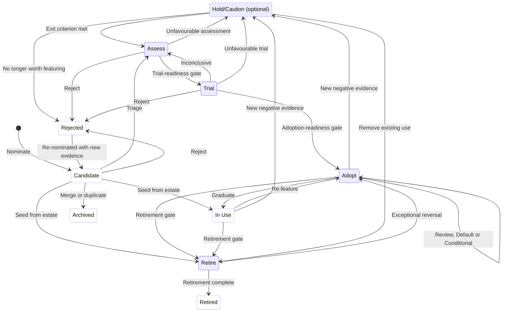

---
tags:
  - guide
  - process
  - technology-radar
aliases: []
doc_id: RG-105
doc_name: process
crumb_id:
document_title: "Technology Radar Intake and Maturation Process"
created_date: 2026-10-23
synopsis: "An evidence-based process and maturity model for nominating technology radar items and moving them along the Assess, Trial, Adopt path, or into the Retire and optional Hold/Caution rings, with gates, trial charters, roles, movement rules, and how the register maps onto radargen's CSV."
status: draft
type: Guide
revision: "1.0"
review_date:
reviewed_by: []
completed_date:
comments: "Copied from the maintainer's notes (drafted with Microsoft Copilot, 2026-10-22). The example edition is docs/examples/, rendered by radargen, in place of the original illustration."
---

# Technology Radar Intake and Maturation Process

**Document status:** Draft for review
**Purpose:** This document describes a lightweight, evidence-based process by which items are added to the technology radar and mature through assessment, trial, and adoption, and by which they are cautioned against or retired.

## 1. Purpose and Guiding Principle

*The technology radar is not only a visualization. It is the visible outcome of a lightweight technology lifecycle and evidence-management process.*

The model rests on one governance principle:

> **Progress along the positive-evidence path (Assess → Trial → Adopt) represents increasing organizational evidence, not increasing enthusiasm or the passage of time.**

An item's ring expresses the organization's current recommendation. Supporting assessments, trials, decisions, and evidence explain why that recommendation is justified. No item advances merely because time has passed; every movement requires new evidence. The same holds for the disposition rings: an item enters Hold/Caution or Retire on the strength of evidence, not by default.

## 2. Core Concepts

The model separates three concepts that are often conflated:

1. **Ring (radar position)** communicates the current organizational recommendation.
2. **Workflow status** tracks progress through the activities that support that recommendation.
3. **Evidence records** justify the recommendation and every movement.

### 2.1 Rings

The ring communicates the organization's recommendation concerning a technology, product, platform, practice, technique, or framework. The model defines four core rings and one optional ring.

| Ring                               | Meaning                                                                                                                                                                                                         | Expected action                                              |
| ---------------------------------- | --------------------------------------------------------------------------------------------------------------------------------------------------------------------------------------------------------------- | ------------------------------------------------------------ |
| **Hold/Caution** *(optional)*    | **Do not progress or use by default.** Assessment, trial, operational experience, or other evidence has identified insufficient value, unacceptable risk, poor fit, immaturity, or another reason for caution. | Avoid, constrain, or monitor.                                |
| **Assess**                         | **Investigate.** There is enough potential relevance to justify structured assessment, but insufficient evidence to warrant a trial.                                                                           | Research and determine whether a trial is warranted.         |
| **Trial**                          | **Experiment.** There is sufficient positive evidence to justify a controlled trial against defined hypotheses and success criteria.                                                                           | Execute a defined trial and collect evidence.                |
| **Adopt**                          | **Recommended.** Evidence supports using the item for appropriate use cases, subject to defined constraints and normal solution governance.                                                                    | Use according to established guidance and constraints.       |
| **Retire**                         | **Move out of use.** The technology is recommended for retirement, or an approved retirement is underway.                                                                                                      | Plan or execute migration, replacement, and decommissioning. |

**Hold/Caution is optional.** An organization may publish the radar with only the four core rings. Section 15.4 describes how negative outcomes are handled when Hold/Caution is not used.

**Adopt is a curated recommendation, not an inventory.** The Adopt ring names what the organization recommends, not everything it runs. An item absent from the radar is "not featured in this edition", not "not in use"; the authoritative record of what is in use is the technology catalogue, of which the radar is a view.

**Adopt is not permanent.** Once an adopted item is established and its recommendation is no longer news, it graduates to **In Use**: a register state, not drawn on the radar, in which the recommendation still stands but the item is no longer featured. This keeps the Adopt ring focused on what has recently been recommended or changed, and stops it from accumulating into an inventory. Section 14.5 describes graduation.

A candidate may be recorded before it is formally placed on the published radar. This prevents the Assess ring from becoming an uncurated list of interesting technologies.

### 2.2 Ring Layout and the Meaning of Position

The rings are laid out from the outer edge to the centre as:

**Hold/Caution (optional) → Assess → Trial → Adopt → Retire**

In this layout, **distance from the centre does not represent maturity**. Proximity to the centre represents the **strength of the organization's action or position**:

- outermost (Hold/Caution, where used): **do not proceed**;
- Assess: **investigate**;
- Trial: **experiment**;
- Adopt: **use**; and
- centre (Retire): **remove**.

*An example edition with all five rings, every other ring shaded. Solid markers in Adopt are Default and hollow ones Conditional; rings and half-rings show movement since the previous edition. The register-only rows in the CSV (Candidate, In Use, Rejected, Retired and Archived) are kept in the register and not drawn. Made from [`docs/examples/`](examples/): `radargen -c docs/examples/radar.toml`.*

Placing Retire at the centre expresses that **Retire is the terminal destination for technology leaving the managed estate**. Once a retirement is complete, the item disappears from the current radar but remains in the historical record. Readers should not interpret Retire as "more mature than Adopt"; the radar's accompanying documentation states this explicitly.

### 2.3 The Positive-evidence Path and Disposition Rings

The rings are not a simple linear progression. The sequence `Hold → Assess → Trial → Adopt → Retire` would wrongly imply that every item starts at Hold and eventually reaches Retire.

Instead:

- **Assess → Trial → Adopt** is the principal **positive-evidence path**; and
- **Hold/Caution** and **Retire** are **disposition rings**, reached for different reasons and from different points in the lifecycle (see Section 15).

The rings and the movements between them form this state model. *Candidate*, *In Use*, *Rejected*, *Retired*, and *Archived* are register states that are not drawn on the radar (Section 2.4); the dashed ring is optional. Any ring or state may also move to Archived when the item is no longer relevant.

### 2.4 Register States

The register behind the radar holds every item the organization has considered, not only those currently drawn. **Every item is in exactly one state at a time**: either one of the drawn rings or one of the register states below. The published radar shows only the drawn rings; register states are recorded and reportable but not drawn.

Each register state answers a distinct question about the item:

| State         | Question it answers                           | Meaning                                                                                                             | Entered from                                 | Leaves to                                                                              | Review                                                 |
| ------------- | --------------------------------------------- | ------------------------------------------------------------------------------------------------------------------- | -------------------------------------------- | -------------------------------------------------------------------------------------- | ------------------------------------------------------ |
| **Candidate** | Has this been looked at yet?                  | Nominated; no recommendation exists yet. Parked items remain here with workflow status `Parked`.                    | Nomination; re-nomination of a Rejected item | Assess (Trial by exception); In Use, Adopt, or Retire when seeding; Rejected; Archived | Next monthly triage; Parked items at their review date |
| **In Use**    | Is this run, and is it still recommended?     | An established adopted item, no longer featured; its Default or Conditional qualifier still applies (Section 14.5). | Adopt (graduation); seeding from the estate  | Adopt, Hold/Caution, Retire                                                            | Initially 24 months, plus event triggers               |
| **Rejected**  | Was this considered, and why was it declined? | Declined on its merits at triage, assessment, trial, or a gate; or a Hold/Caution item no longer worth featuring.   | Candidate, Assess, Trial, Hold/Caution       | Candidate, only on re-nomination with new evidence                                     | None scheduled                                         |
| **Retired**   | Was this run, and when did it go?             | Retirement is complete and verified against the completion criteria (Section 16.3).                                 | Retire                                       | None in normal operation                                                               | None                                                   |
| **Archived**  | Why is this no longer tracked?                | No longer relevant, a duplicate, or merged into another item, in which case it links to the surviving item.         | Any ring or state                            | None                                                                                   | None                                                   |

The register states follow these rules:

- **State and workflow status stay separate.** A register state, like a ring, records the recommendation or outcome; workflow status records progress within it. A Candidate may be `Awaiting Triage`, `Clarification Requested`, or `Parked`.
- **Rejected and Hold/Caution are both negative, for different audiences.** Hold/Caution publishes a warning that readers need, because they are likely to encounter the item. Rejected records the decision without featuring it. Where Hold/Caution is not used, every negative outcome leads to Rejected.
- **Rejected is a judgement; Archived is administrative.** Rejected means the item was declined on its merits. Archived means it is no longer tracked for reasons unrelated to merit, such as irrelevance or duplication.
- **Retired preserves estate history.** Retired records that the organization ran the item and deliberately removed it, and when. Archiving a retired item would lose that.
- **Re-nomination requires new evidence.** A Rejected item returns to Candidate only with evidence that addresses the reasons recorded for its rejection.
- **Nothing is deleted.** Archived is the final state. Every item keeps its decision history and evidence links in whatever state it ends.

### 2.5 Adoption Qualifier: Default and Conditional

Every adopted item, whether featured in the Adopt ring or graduated to In Use (Section 14.5), carries one of two qualifiers:

| Qualifier       | Meaning                                                                                            | Expected action                                                                                       |
| --------------- | -------------------------------------------------------------------------------------------------- | ----------------------------------------------------------------------------------------------------- |
| **Default**     | The standard choice for its use cases.                                                             | Use unless a documented reason applies; deviation from the default requires justification.            |
| **Conditional** | Adopted, but permitted only in the circumstances the rationale states.                             | Use only where the stated conditions apply; outside them, the Default item or another approved option applies. |

The qualifier follows these rules:

- **It is a qualifier, not a ring.** A Conditional item is genuinely adopted. Conditional is neither a lesser lifecycle stage nor a step on the way to Default or Hold/Caution.
- **It applies to adopted items only.** The qualifier applies in Adopt and In Use, and carries over unchanged when an item graduates. Items in other rings carry no qualifier.
- **Conditions are explicit.** Every Conditional item states, in its rationale, the use cases, environments, data classifications, platforms, or services in which it is permitted and, where one exists, the Default item to use otherwise.
- **Defaults do not overlap silently.** Where two Default items serve the same need, the overlap is either deliberate and explained or a decision is raised to resolve it.
- **The qualifier is decided at the gate.** The Trial-to-Adopt gate (Section 12) decides whether an item enters Adopt as Default or Conditional.
- **Changing the qualifier is a movement decision.** Narrowing Default to Conditional, or broadening Conditional to Default, is recorded with rationale and evidence even though the ring does not change. Narrowing to Conditional is a common response to weakening evidence, particularly where the Hold/Caution ring is not used.

### 2.6 Workflow Status

The ring does not represent workflow progress. Workflow status describes where an item stands within the activity that supports its current or proposed ring.

For an item in the **Trial** ring:

`Proposed → Approved → Planned → In Progress → Completed → Decision Recorded`

For an item in the **Retire** ring:

`Retirement Proposed → Retirement Approved → Retirement Planned → Retirement In Progress → Retirement Complete`

On completion, the item moves from the Retire ring to the Retired register state.

This distinction allows an item to remain in one ring while the action resulting from that recommendation progresses through controlled workflow states. The Retire ring, for example, covers both *recommended for retirement* and *actively being retired*; workflow status distinguishes the two. A retiring item might be recorded as:

> **Ring:** Retire
> **Status:** Retirement In Progress
> **Replacement:** OpenShift 4.x
> **Target retirement:** 2027-03-31

The same design principle applies throughout: **the ring communicates the organization's recommendation; workflow status communicates where the action resulting from that recommendation currently stands.**

### 2.7 Evidence Records

Evidence records justify decisions and movements. They may include:

- nomination records;
- assessment records;
- trial charters;
- success criteria and measurements;
- architecture and security assessments;
- technical test results;
- cost models;
- operational readiness findings;
- user or stakeholder feedback;
- decision records; and
- links to supporting artefacts.

## 3. End-to-end Process

The principal lifecycle is:

`Nominate → Triage → Assess → Trial Readiness Gate → Plan Trial → Execute Trial → Evaluate Evidence → Adoption Readiness Gate → Adopt`

Items may leave or pause the principal path through these outcomes:

- reject, moving the item to Rejected;
- merge with an existing item, moving it to Archived;
- park for later review, remaining a Candidate;
- remain in Assess;
- return from Trial to Assess;
- move to Hold/Caution, where that ring is used;
- graduate from Adopt to In Use;
- move to Retire, and on completion to Retired; or
- archive, when the item is no longer relevant.

Two subordinate lifecycles run within individual rings. Once a trial is proposed:

`Trial Proposed → Trial Approved → Trial Planned → Trial In Progress → Trial Completed → Evidence Reviewed → Decision Recorded`

Once a retirement is proposed:

`Retirement Proposed → Retirement Approved → Retirement Planned → Retirement In Progress → Retirement Complete`, after which the item moves to Retired and leaves the current radar.

## 4. Roles and Responsibilities

| Role                         | Responsibilities                                                                                                                                    |
| ---------------------------- | --------------------------------------------------------------------------------------------------------------------------------------------------- |
| **Proposer**                 | Submits the candidate and explains the initial problem, opportunity, or source of interest.                                                         |
| **Radar item owner**         | Maintains the item, coordinates assessment activity, keeps evidence current, and brings movement proposals forward.                                 |
| **Trial owner**              | Owns the trial charter, execution, evidence collection, and final recommendation.                                                                   |
| **Transition owner**         | Owns the retirement plan, replacement, and target date for an item in the Retire ring.                                                              |
| **Sponsor**                  | Confirms the organizational relevance of the trial and supports access to required resources.                                                       |
| **Subject-matter reviewers** | Provide security, privacy, architecture, operations, commercial, data, and other specialist assessments as required.                                |
| **Radar Working Group**      | Triages nominations, reviews movement proposals, approves appropriate trials, and records decisions.                                                |
| **Decision authority**       | Approves recommendations that exceed the delegated authority of the Radar Working Group, such as major investment or production adoption decisions. |

One person may hold several roles for a small assessment, but every item, trial, and retirement has a named owner.

## 5. New-item Intake Process

### 5.1 Nomination

Anyone with appropriate access may nominate an item. Intake remains deliberately lightweight so that potentially valuable signals are not lost because the proposer cannot yet complete a full assessment.

#### Minimum Required Information

| Field                      | Description                                                                                                                                  |
| -------------------------- | -------------------------------------------------------------------------------------------------------------------------------------------- |
| **Name**                   | Recognizable name of the product, technology, platform, technique, practice, or framework.                                                   |
| **Item type**              | Tool, platform, practice, technique, language, framework, or another approved category.                                                      |
| **Problem or opportunity** | Why the item may matter to the organization.                                                                                                 |
| **Source**                 | Where the signal originated, such as a project, vendor briefing, client requirement, industry publication, incident, or internal experiment. |
| **Proposer**               | Person submitting the nomination.                                                                                                            |

#### Additional Useful Information

- description;
- potential use cases;
- current internal usage;
- known alternatives;
- relevant organizational capabilities or services;
- supporting links;
- vendor or community information;
- preliminary risks or constraints;
- proposed ring, normally Assess; and
- date nominated.

The intake form does not require the proposer to complete a full architecture, security, commercial, or operational assessment.

### 5.2 Triage

The Radar Working Group reviews nominations, preferably on a monthly cadence.

Triage answers three questions:

1. Is the item relevant to the organization's technology landscape, services, clients, or strategic direction?
2. Is there enough substance to warrant investigation?
3. Is it sufficiently distinct from an existing radar item?

#### Triage Outcomes

| Outcome                           | Applies when                                                                                                                            |
| --------------------------------- | --------------------------------------------------------------------------------------------------------------------------------------- |
| **Accept into Assess**            | The item is relevant and warrants structured investigation.                                                                             |
| **Request limited clarification** | A small amount of missing information prevents a decision.                                                                              |
| **Merge**                         | An existing item already represents the same technology or recommendation. The nomination moves to Archived, linked to that item.       |
| **Park**                          | The item is potentially relevant, but timing, maturity, or available capacity does not justify assessment. It remains a Candidate with workflow status `Parked`. |
| **Reject**                        | The item is out of scope, immaterial, or lacks a credible problem or opportunity. It moves to Rejected.                                 |
| **Propose direct Trial entry**    | Strong existing internal evidence and a defined experiment justify bypassing a separate Assess period. This is treated as an exception. |

Every outcome includes a short rationale and, where applicable, a review date.

### 5.3 Seeding From the Existing Estate

When the radar is first populated, or when existing estate technologies are brought under radar governance, an item may enter directly into:

- **In Use**, where the technology is established in the estate and existing production use and evidence already support the recommendation;
- **Adopt**, where such a technology is also to be actively featured, for example because it is a recently chosen standard; or
- **Retire**, where the technology has already been identified for retirement.

Seeding established technologies into In Use rather than Adopt keeps the first edition's Adopt ring from opening as an inventory.

Direct entry still requires a rationale, an owner, and a review date. A direct Retire entry also requires a transition owner and, where known, a replacement and target retirement date.

## 6. Assess Stage

### 6.1 Objective

The Assess stage answers:

> **Is this item sufficiently promising, relevant, and feasible that the organization should invest resources in a controlled trial?**

Assess does not require proof that the technology should be adopted. It requires enough understanding to decide whether a trial is worthwhile and safe to undertake.

### 6.2 Assessment Dimensions

Each dimension receives a simple qualitative judgment, such as **Low/Medium/High**, **Favourable/Mixed/Unfavourable**, or **Sufficient/Insufficient**, supported by rationale. The model avoids a mathematically precise aggregate score unless the organization can justify the weighting and decision thresholds.

| Dimension                              | Assessment question                                                                                                  |
| -------------------------------------- | -------------------------------------------------------------------------------------------------------------------- |
| **Strategic relevance**                | Does the item support a needed capability, service, client requirement, or strategic direction?                      |
| **Problem fit**                        | Is there a meaningful and sufficiently specific problem or use case?                                                 |
| **Potential value**                    | What measurable technical, service, financial, risk, or operational improvement could result?                        |
| **Technical fit**                      | Is it reasonably compatible with the target architecture, platforms, standards, and integration environment?         |
| **Operational fit**                    | Could it be supported, monitored, patched, recovered, and governed?                                                  |
| **Security, privacy, and compliance**  | Are there apparent blockers involving data protection, sovereignty, access, supply chain, or regulatory obligations? |
| **Maturity**                           | Is the item mature enough for the proposed experiment and risk profile?                                              |
| **Ecosystem and support**              | Are vendor support, community health, skills, documentation, and dependencies adequate?                              |
| **Commercial and cost considerations** | Are licensing, procurement, consumption, exit, and likely lifecycle costs understood enough to proceed?              |
| **Differentiation**                    | Does the item provide meaningful value beyond existing or already approved alternatives?                             |
| **Trial feasibility**                  | Can the important uncertainties be tested within a bounded duration, cost, and environment?                          |

### 6.3 Assessment Outcomes

- continue assessing;
- propose movement to Trial;
- park pending a condition or date;
- move to Hold/Caution, where the assessment finds the item unsuitable and that ring is used;
- reject, moving the item to Rejected; or
- merge with another item.

Each outcome includes a concise rationale, identified evidence gaps, and a next review date.

## 7. Assess-to-Trial Readiness Gate

Moving an item from Assess to Trial is a governance decision. It signifies that the organization has enough evidence to justify expending effort on a controlled experiment.

An item moves to Trial only when the following information is available and considered sufficient.

### 7.1 Defined Problem

- What specific problem or opportunity is being tested?
- Who experiences the problem?
- Why is it important?
- What is the relevant baseline or current approach?

### 7.2 Testable Hypothesis

Each hypothesis follows this structure:

> **\[Technology or practice] is expected to improve \[outcome] for \[use case]. The hypothesis is considered demonstrated if \[measurable evidence].**

Example:

> GitOps is expected to reduce configuration drift for Kubernetes platform configuration. The hypothesis is considered demonstrated if deliberately introduced drift is detected and reconciled automatically and all configuration changes remain attributable through version-control history.

### 7.3 Bounded Scope

The proposal identifies:

- included use cases;
- excluded use cases;
- environment;
- integrations;
- data classification;
- participating users or teams;
- dependencies; and
- assumptions and constraints.

### 7.4 Ownership and Sponsorship

The trial has:

- a named trial owner;
- an accountable sponsor;
- identified technical and specialist reviewers; and
- confirmation that required participants can support the proposed period.

### 7.5 Duration and Resources

The proposal defines:

- planned start and end dates;
- people and skills required;
- infrastructure and environments;
- licences or subscriptions;
- vendor involvement;
- expected direct cost; and
- material opportunity cost.

A typical technology trial is bounded to approximately 4 to 8 weeks. Shorter trials suit narrowly testable questions. A trial expected to run for several months is examined to determine whether it has become a project or implementation initiative (see Section 13).

### 7.6 Measurable Success Criteria

A trial normally has 3 to 7 material success criteria. Each criterion defines:

- metric or observable condition;
- baseline, where applicable;
- target;
- evidence source; and
- decision rule.

### 7.7 Risk and Control Assessment

Material risks and required controls are identified before execution. Depending on the item, these may include:

- security and threat considerations;
- privacy and data residency;
- identity and privileged access;
- licensing and intellectual property;
- vendor and supply-chain risk;
- interoperability and dependency risk;
- production isolation;
- operational support;
- data disposal; and
- trial termination and cleanup.

### 7.8 Trial-readiness Checklist

An item is ready to move to Trial when all mandatory conditions are met:

- [ ] A specific problem or opportunity is defined.
- [ ] A representative use case is identified.
- [ ] A testable hypothesis is documented.
- [ ] Scope and exclusions are explicit.
- [ ] A trial owner and sponsor are named.
- [ ] Duration, resources, and expected cost are defined.
- [ ] Success criteria are measurable.
- [ ] Evidence sources are identified.
- [ ] Material risks and controls have been reviewed.
- [ ] The proposed environment and data classification are appropriate.
- [ ] Exit options and decision authority are understood.

### 7.9 Gate Decision

The possible decisions are:

- approve movement to Trial;
- approve with conditions;
- return for additional assessment;
- park;
- move to Hold/Caution, where that ring is used; or
- reject.

The decision, conditions, rationale, approver, and date are recorded.

## 8. Trial Charter

Each approved trial has a concise charter. The charter is both the execution plan and the basis for evaluating the result.

### 8.1 Trial Identification

- **Radar item:**
- **Trial title:**
- **Trial owner:**
- **Sponsor:**
- **Technical lead:**
- **Specialist reviewers:**
- **Start date:**
- **Target end date:**
- **Workflow status:**

### 8.2 Objective

The uncertainties or questions the trial will resolve.

### 8.3 Hypothesis

The expected outcome, the use case it applies to, and the evidence that would demonstrate it.

### 8.4 Representative Use Case

The scenario used to test the item. The use case is realistic enough to expose meaningful integration, security, operational, and usability characteristics.

### 8.5 Scope

#### Included

- systems, integrations, and features;
- users or roles;
- data and environments; and
- test scenarios.

#### Excluded

- production deployment unless explicitly authorized;
- capabilities not necessary to test the hypothesis;
- broad implementation, migration, or organizational rollout; and
- unrelated product evaluation.

### 8.6 Environment

The charter identifies whether the trial uses:

- lab;
- sandbox;
- non-production shared environment;
- isolated proof-of-concept environment; or
- controlled production activity approved through normal change and risk governance.

### 8.7 Duration and Checkpoints

- planned start;
- planned completion;
- midpoint review for trials longer than approximately four weeks;
- evidence review date; and
- final decision date.

The midpoint review confirms that the trial is still testing the original hypothesis and has not quietly become an implementation project.

### 8.8 Resources and Cost

- participants and expected effort;
- infrastructure;
- licences;
- vendor services;
- training;
- direct costs; and
- cleanup or decommissioning costs.

### 8.9 Risks, Constraints, and Controls

Material risks, constraints, mitigations, owners, and acceptance decisions.

### 8.10 Success Criteria

| ID    | Criterion | Metric or observable condition | Baseline | Target | Evidence source | Result        |
| ----- | --------- | ------------------------------ | -------- | ------ | --------------- | ------------- |
| SC-01 |           |                                |          |        |                 | Not evaluated |
| SC-02 |           |                                |          |        |                 | Not evaluated |
| SC-03 |           |                                |          |        |                 | Not evaluated |

### 8.11 Exit Options

At completion, the trial results in one of these recommendations:

- move to Adopt;
- extend or repeat the Trial with an explicitly revised charter;
- return to Assess;
- move to Hold/Caution, where that ring is used;
- reject, moving the item to Rejected; or
- move to Retire, where the evidence concerns an existing technology.

A trial never simply "finishes" without a recorded decision.

## 9. Success-criteria Guidance

Criteria test the assumptions that matter to a decision, not merely that the product can be installed.

| Criterion type           | Example                                                                                                                                 |
| ------------------------ | --------------------------------------------------------------------------------------------------------------------------------------- |
| **Functional**           | The item completes the selected end-to-end use case without critical manual workarounds.                                                |
| **Performance**          | The test workload meets the agreed throughput, response-time, or scale target.                                                          |
| **Integration**          | The item integrates with required identity, logging, monitoring, automation, or service-management platforms.                           |
| **Security**             | No unresolved Critical or High findings remain for the trial scope, or exceptions are explicitly accepted by the appropriate authority. |
| **Privacy and data**     | Data location, retention, access, and disposal meet the stated classification and policy requirements.                                  |
| **Operational**          | The item can be monitored, patched, backed up, restored, and supported through a defined operating model.                               |
| **Usability**            | Representative users can complete the target workflow with acceptable effort and error rates.                                           |
| **Reliability**          | The item behaves predictably during defined failure and recovery scenarios.                                                             |
| **Economic**             | The estimated lifecycle cost falls within the agreed threshold and does not depend on an unacceptable licensing assumption.             |
| **Portability and exit** | Configuration and data can be exported, migrated, or decommissioned within acceptable constraints.                                      |

Every criterion produces evidence that another reviewer can inspect.

## 10. Trial Execution and Evidence Collection

### 10.1 Kick-off

At trial start, the trial owner:

- confirms the charter;
- confirms environment and access;
- records baseline measurements;
- assigns evidence owners;
- confirms risk controls; and
- confirms the final decision date.

### 10.2 Execution

The trial executes predetermined scenarios rather than becoming an open-ended product demonstration. Deviations are recorded when they affect the validity of the result.

### 10.3 Evidence Collection

Evidence is captured while the work occurs. Suitable evidence may include:

- test scripts and results;
- benchmark output;
- configuration and pipeline records;
- logs and monitoring results;
- screenshots where they add value;
- architecture diagrams;
- security and privacy findings;
- cost estimates and licensing assumptions;
- operational assessments;
- user feedback;
- defects, limitations, and workarounds; and
- vendor or support clarification.

Evidence is stored in a durable location and linked to the radar item and trial record.

### 10.4 Change Control

If the hypothesis, scope, duration, cost, or success criteria materially change, the charter is updated and reapproved. Criteria are not reinterpreted after the result is observed merely to make a trial appear successful.

### 10.5 Early Termination

A trial may be stopped early when:

- a critical risk or policy issue emerges;
- the hypothesis has already been disproved;
- required dependencies or resources are unavailable;
- the technology cannot satisfy a mandatory criterion; or
- continuing would provide little additional decision value.

Early termination is a valid evidence-based outcome, not a failed process.

## 11. Trial Exit Assessment

At completion, each criterion is evaluated and its evidence recorded.

| Result            | Meaning                                                                                        |
| ----------------- | ---------------------------------------------------------------------------------------------- |
| **Pass**          | Target was met and evidence is sufficient.                                                     |
| **Partial**       | Some evidence is favourable, but the target was not fully met or material uncertainty remains. |
| **Fail**          | Target was not met.                                                                            |
| **Not evaluated** | Criterion was not tested; the reason and decision impact are recorded.                         |

The exit assessment summarizes:

- expected benefits confirmed;
- unexpected benefits;
- limitations and failure modes;
- unresolved risks;
- operational implications;
- integration implications;
- skills and support implications;
- commercial and cost implications;
- portability and exit implications;
- confidence in the evidence; and
- recommended radar movement.

### 11.1 Trial Decision Template

- **Overall result:** Successful / Partially successful / Unsuccessful / Inconclusive
- **Recommendation:** Adopt / Extend Trial / Return to Assess / Hold / Reject / Retire
- **Decision rationale:**
- **Conditions or limitations:**
- **Approved use cases:**
- **Excluded or discouraged use cases:**
- **Residual risks:**
- **Required follow-up:**
- **Decision authority:**
- **Decision date:**
- **Next review date:**

## 12. Trial-to-Adopt Readiness Gate

A successful proof of concept does not automatically justify Adopt. The model draws this distinction:

> **Trial demonstrates that the item can work for a defined use case. Adopt means the organization is prepared to recommend and support its use in appropriate production solutions.**

Before movement to Adopt, the following are confirmed:

- [ ] Trial success criteria have been evaluated and supporting evidence is available.
- [ ] Appropriate production use cases and limitations are documented.
- [ ] The production architecture or reference pattern is sufficiently understood.
- [ ] Security, privacy, compliance, and data requirements are understood.
- [ ] Licensing, procurement, consumption, and lifecycle cost implications are understood.
- [ ] An operational owner and support model are identified.
- [ ] Monitoring, patching, backup, recovery, and continuity expectations are understood.
- [ ] Required skills are available or can realistically be obtained.
- [ ] Integration and dependency patterns are understood.
- [ ] Material risks have owners, treatments, or formally accepted exceptions.
- [ ] Implementation guidance or guardrails exist at an appropriate level.
- [ ] Exit, migration, and decommissioning considerations are understood.

The possible decisions are:

- approve movement to Adopt as **Default**;
- approve movement to Adopt as **Conditional**, with the conditions stated;
- require an extended or additional Trial;
- return to Assess;
- move to Hold/Caution, where that ring is used; or
- reject.

Section 2.5 defines the Default and Conditional qualifiers.

Adopt does not replace normal project, solution architecture, security, privacy, procurement, or change governance.

## 13. Distinguishing a Trial From a Project

> **A trial is designed to answer questions. A project is designed to deliver an outcome.**

| Trial                                               | Project                                                    |
| --------------------------------------------------- | ---------------------------------------------------------- |
| Tests a hypothesis                                  | Delivers a committed capability or service                 |
| Has bounded experimental scope                      | Has delivery scope and acceptance criteria                 |
| May conclude that the technology should not proceed | Is normally expected to produce an implemented outcome     |
| Optimizes for learning                              | Optimizes for delivery                                     |
| Uses evidence to support a recommendation           | Uses approved technology and designs to produce a solution |

Example trial question:

> Can platform automation reduce provisioning effort and configuration variance sufficiently to justify adoption?

Example project outcome:

> Implement the approved automation platform for a defined service or client environment.

An initiative that already has a committed production outcome, substantial implementation scope, or a multi-month delivery plan is normally governed as a project rather than labelled as a technology trial.

## 14. Adopt Review and Reaffirmation

### 14.1 Purpose

Adopt is a standing recommendation, and the evidence behind it decays: vendors change direction, costs move, alternatives appear, and operational experience accumulates. The Adopt review confirms that the recommendation, and its qualifier, still hold.

Reaffirmation is itself evidence-based. A review that gathers no new evidence does not reaffirm an item, and the absence of objections is not evidence.

### 14.2 Triggers

An Adopt item is reviewed:

- **on schedule**, within the agreed review cycle (initially 12 months; a shorter cycle may apply to Conditional items); and
- **on event**, when any of the following occurs:
	- vendor end-of-support, roadmap change, acquisition, or licensing change;
	- a critical vulnerability or security incident involving the item;
	- a material change in cost;
	- the emergence of a credible alternative, including an item reaching Adopt that serves the same need;
	- recurring operational incidents attributable to the item;
	- a change in strategy, architecture standards, or regulatory obligations; or
	- repeated requests to use a Conditional item outside its stated conditions.

### 14.3 Review Dimensions

| Dimension                         | Review question                                                                                              |
| --------------------------------- | ------------------------------------------------------------------------------------------------------------ |
| **Continued fit**                 | Does the item still serve the use cases it was adopted for, within the current target architecture?          |
| **Vendor and ecosystem health**   | Are support, roadmap, community activity, and skills availability still adequate?                            |
| **Security and compliance**       | Have new findings, incidents, or obligations changed the risk profile?                                       |
| **Cost**                          | Do actual lifecycle costs match the assumptions made at adoption?                                            |
| **Operational experience**        | What do incidents, support effort, and service owners' experience show?                                      |
| **Alternatives**                  | Has a better-suited or already-approved alternative emerged?                                                 |
| **Qualifier**                     | For a Default item, is it still the standard choice? For a Conditional item, are the conditions still right? |
| **Usage**                         | Is the recommendation followed in practice, and are deviations explained?                                    |

### 14.4 Review Outcomes

- **Reaffirm:** the recommendation stands; the last reviewed date and next review date are updated.
- **Reaffirm with revised guidance:** the recommendation stands, with updated rationale, conditions, or implementation guidance.
- **Narrow (Default → Conditional):** the item remains adopted but only in stated circumstances.
- **Broaden (Conditional → Default):** evidence supports the item as the standard choice; this requires evidence of suitability beyond the original conditions.
- **Move to Hold/Caution**, where that ring is used: further adoption stops or proceeds only with caution.
- **Propose Retire:** the item proceeds to the retirement gate (Section 16).
- **Graduate to In Use:** the recommendation stands, but the item is established and no longer needs featuring (Section 14.5).

Each outcome is recorded as a decision with rationale, evidence, and the next review date.

### 14.5 Graduation to In Use

**In Use** is a register state for established technologies whose recommendation still stands but which no longer need featuring on the radar. Graduation keeps the Adopt ring a short list of current recommendations rather than a growing inventory.

#### Graduation Criteria

An Adopt item is a candidate for graduation when:

- it has remained in Adopt without change for an agreed period (initially four editions, or about a year);
- implementation guidance, reference patterns, and the support model are established;
- it is broadly used across its intended use cases, and its use no longer needs promoting; and
- no conditions, exceptions, or decisions concerning it are open.

When the Adopt ring grows beyond an agreed size, the longest-standing stable items are considered first. Graduation is a decision of the Radar Working Group, taken at an Adopt review or during edition preparation, and recorded as a movement decision.

#### Meaning of In Use

- **The recommendation is unchanged.** In Use is not a downgrade: the item remains recommended for its use cases, and it keeps its Default or Conditional qualifier. Conditional items keep their stated conditions, and the qualifier can still be narrowed or broadened as a recorded movement decision.
- **It stays governed.** In Use items keep an owner and are reviewed on a longer cycle (initially 24 months), plus the event triggers in Section 14.2.
- **It stays visible.** In Use items remain in the register and the technology catalogue, and may be published in the radar's table view without being drawn.
- **Graduation is announced as such.** Edition notes list items that moved to In Use separately from items that moved to Rejected, Retired, or Archived, so readers do not mistake graduation for a negative signal.

#### Leaving In Use

- **In Use → Adopt:** the item is featured again, for example because it becomes the Default for a broader set of use cases or significant new guidance is issued.
- **In Use → Hold/Caution**, where that ring is used: new evidence means further use should stop or proceed only with caution.
- **In Use → Retire:** the item passes the retirement gate (Section 16). For established technologies, this is the most common route to Retire.

An organization that prefers to show the estate on the radar itself may draw In Use as a ring between Adopt and Retire. This moves crowding into another band rather than removing it, so In Use is normally kept off the radar.

## 15. Disposition Rings: Hold/Caution and Retire

### 15.1 Hold/Caution

Where used, **Hold/Caution is an evidence-based negative recommendation**, not merely an entry or waiting state. It is a destination reached after assessment, trial, or operational experience produces unfavourable evidence, rather than a place where items are paused.

An item reaches Hold/Caution through one of these movements:

- **Assess → Hold/Caution:** assessment finds the item unsuitable.
- **Trial → Hold/Caution:** experimentation produces unfavourable evidence.
- **Adopt → Hold/Caution:** new information means further adoption should stop or proceed only with caution.

An item leaves Hold/Caution through:

- **Hold/Caution → Assess:** an exit criterion is met, or circumstances otherwise materially change, and reconsideration is justified;
- **Hold/Caution → Retire:** existing use of a cautioned item is to be actively removed; or
- **Hold/Caution → Rejected:** the warning no longer serves readers, and the decision is recorded without being featured.

Every Hold/Caution item carries an explicit rationale, one or more exit criteria, and a review date.

#### Exit Criteria

Without defined exit conditions, Hold/Caution becomes a permanent resting place. The decision that moves an item into Hold/Caution therefore also records the **exit criteria** for that item: the observable conditions under which the recommendation would be reconsidered.

Exit criteria are defined **per item**, because they follow from the specific evidence that placed the item in the ring. Typical forms include:

- **Release:** a new major release, or a release that addresses the specific deficiency found in assessment or trial.
- **Remediation:** the vendor resolves an identified security, privacy, or compliance finding.
- **Commercial:** licensing, pricing, or contract terms change in a way that removes the commercial objection.
- **Ecosystem:** support, community activity, skills availability, or integrations reach a stated threshold.
- **Need:** the organization's requirements, architecture standards, or regulatory obligations change so that the original poor fit no longer applies.
- **Comparison:** a preferred alternative is retired or fails, removing the reason this item was disfavoured.

Each exit criterion is specific enough that the item owner can tell when it has been met, for example "a release that supports the organization's identity provider natively", rather than "the product matures".

Exit criteria work as follows:

- **Meeting a criterion triggers reconsideration, not movement.** The item owner brings a Hold/Caution → Assess proposal to the Radar Working Group, with the evidence that the criterion has been met. Re-entry is to Assess, not directly to Trial, because the original evidence is superseded rather than reversed.
- **The review date is a backstop.** If no criterion has been met by the review date (initially 12 months after entry), the Radar Working Group decides to:
	- keep the item in Hold/Caution, with refreshed exit criteria and a new review date;
	- move it to Rejected, where the warning no longer serves readers; or
	- move it to Retire, where the item is in use and that use should now be removed.
- **An item with no plausible exit is a deliberate choice.** Where no realistic change would alter the recommendation, the item is either moved to Rejected, with its decision record retained, or kept as a standing warning with that intent stated in its rationale.

### 15.2 Retire

**Retire** is the terminal disposition for technology leaving the managed estate. An item reaches Retire through:

- **Adopt → Retire** or **In Use → Retire:** an established technology is to be removed from use;
- **Hold/Caution → Retire:** a cautioned technology that is already in use is to be removed; or
- **direct entry** when the radar is seeded with estate technologies already identified for retirement (Section 5.3).

In exceptional circumstances, a retirement decision may be reversed (**Retire → Adopt** or **Retire → Assess**). A reversal requires the same evidence and rationale as any other movement.

Every Retire item has a transition owner and, where known, a replacement and target retirement date. Section 16 describes the retirement gate, plan, and completion criteria. Workflow status tracks the retirement through to completion (Section 2.6), after which the item moves to the Retired register state and leaves the current radar.

### 15.3 Distinguishing Hold/Caution From Retire

The two disposition rings answer different questions:

> **Hold/Caution answers "Should the organization take this up?"**
> **Retire answers "Should the organization continue using what it already has?"**

Examples:

- A new database product is trialled and performs poorly → **Hold/Caution**.
- An existing hypervisor reaches end of support and must be replaced → **Retire**.
- An Adopt technology develops a serious unresolved security concern → possibly **Hold/Caution** initially.
- A formal decision is then made to remove it from the estate → **Retire**.

### 15.4 Operating Without the Hold/Caution Ring

Hold/Caution is optional. An in-house radar governs an estate the organization actually operates, where the more pressing question is what must be removed; Retire, with an owner and an exit date, therefore carries more weight than a cautionary ring. An organization may publish only the four core rings (Assess, Trial, Adopt, Retire).

Without Hold/Caution, the outcomes that would otherwise lead there are handled as follows:

| Situation                                                  | Outcome without Hold/Caution                                                                                                       |
| ---------------------------------------------------------- | ------------------------------------------------------------------------------------------------------------------------------------ |
| Assessment finds the item unsuitable                       | Move to Rejected; the decision record and rationale are retained.                                                                   |
| Trial produces unfavourable evidence                       | Move to Rejected, or return to Assess if the evidence is inconclusive.                                                               |
| New evidence weakens an Adopt recommendation               | Constrain the item to conditional adoption with stated circumstances, or move it to Retire if a planned transition is warranted.    |
| Cautioned item already in use                              | Move to Retire.                                                                                                                      |

Rejected items remain in the register (Section 2.4) with their decision history, so the organization can still answer "was this considered, and why was it declined?" even though the item is not drawn on the radar.

## 16. Retirement Gate, Plan, and Completion

### 16.1 Retirement Readiness Gate

Moving an item to Retire commits the organization to removing it from use. Before that commitment, the following are confirmed:

- [ ] The reason for retirement is documented: obsolescence, end of support, risk, cost, strategic change, or a preferred replacement.
- [ ] Current usage is identified: the services, systems, teams, clients, and integrations that depend on the item.
- [ ] A replacement is identified, or an explicit decision records that none is needed.
- [ ] The replacement is in Adopt, or has an approved path to it.
- [ ] The migration approach and effort are estimated.
- [ ] The risk of continuing is compared with the risk and cost of retiring.
- [ ] Data retention, migration, and disposal requirements are understood.
- [ ] Contractual and licensing implications, including notice periods and renewal dates, are understood.
- [ ] The owners of affected services have been consulted.
- [ ] A transition owner is named.
- [ ] A target retirement date is set.

The possible decisions are:

- approve movement to Retire;
- approve with conditions;
- defer, with the item remaining in its current ring and a review date set;
- move to Hold/Caution, where that ring is used, to stop new use without yet committing to removal; or
- reject the proposal.

Approval to Retire takes effect for new use immediately: any new use of a Retire item requires an approved exception.

### 16.2 Retirement Plan

Each approved retirement has a concise plan, the counterpart of the trial charter.

- **Radar item:**
- **Transition owner:**
- **Sponsor:**
- **Reason for retirement:**
- **Replacement:**
- **Target retirement date:**
- **Workflow status:**

The plan covers:

- **Scope:** affected services, systems, teams, clients, and integrations, and anything explicitly out of scope;
- **Migration approach:** sequencing, waves, and dependencies on the replacement;
- **Milestones:** no-new-use date, migration complete, decommissioning complete, and contracts ended;
- **Risks and controls:** material risks, mitigations, and owners;
- **Data handling:** retention, migration, archival, and disposal;
- **Commercial actions:** licence reductions, contract terminations, and notice deadlines;
- **Exceptions:** any service permitted to continue beyond the target date, each with an owner and expiry date; and
- **Communication:** who is informed, and when.

### 16.3 Completion Criteria

An item moves from Retire to the **Retired** register state only when:

- [ ] No production usage remains, verified through inventory, telemetry, or equivalent evidence rather than assertion.
- [ ] Integrations are removed or redirected.
- [ ] Data is migrated, archived, or disposed of in line with retention requirements.
- [ ] Infrastructure is decommissioned, and associated credentials, accounts, and secrets are revoked.
- [ ] Licences and support contracts are terminated or will not be renewed.
- [ ] The technology catalogue and configuration records are updated.
- [ ] Any remaining approved exceptions are recorded with an owner and expiry date.

Once Retired, the item leaves the current radar at the next edition and remains in the register with its history.

### 16.4 Missed Target Dates

When a target retirement date passes without completion, the transition owner reports to the Radar Working Group, which decides to:

- revise the target date, with rationale, as a re-approved decision;
- approve time-limited exceptions for specific services while the rest proceeds;
- escalate to the decision authority where the residual risk is material, for example where vendor support has already ended; or
- in exceptional circumstances, reverse the retirement (Section 15.2).

A second revision of the same target date escalates to the decision authority automatically.

## 17. Radar Movement Rules

| Movement                              | Required basis                                                                                                                                |
| ------------------------------------- | --------------------------------------------------------------------------------------------------------------------------------------------- |
| **Candidate → Assess**                | Relevance and enough substance to justify structured investigation.                                                                           |
| **Candidate → In Use / Adopt / Retire** | Seeding from the existing estate, with existing evidence, an owner, and a review date (Section 5.3).                                        |
| **Assess → Trial**                    | Defined problem, testable hypothesis, bounded scope, owner, sponsor, duration, resources, risks, and measurable success criteria.             |
| **Assess → Hold/Caution**\*         | Assessment finds insufficient value, unacceptable risk, poor fit, or immaturity.                                                              |
| **Trial → Adopt**                     | Completed evidence review plus sufficient production, operational, security, privacy, commercial, and support readiness.                      |
| **Trial → Assess**                    | Evidence was inconclusive, assumptions changed, or further investigation is needed before another controlled trial.                           |
| **Trial → Hold/Caution**\*          | Negative evidence or unresolved risk indicates that trial or use should be constrained or discouraged.                                        |
| **Adopt → Hold/Caution**\*          | New evidence weakens the recommendation, but an immediate planned transition is not yet warranted.                                            |
| **Adopt: Default ↔ Conditional**      | An Adopt review or new evidence shows the item's appropriate scope has narrowed or broadened (Sections 2.5 and 14).                           |
| **Adopt → In Use**                    | The item meets the graduation criteria: stable, established, broadly used, and with nothing open (Section 14.5).                              |
| **In Use → Adopt**                    | The item warrants featuring again, such as a broadened Default or significant new guidance.                                                   |
| **In Use → Hold/Caution**\*           | New evidence means further use should stop or proceed only with caution.                                                                      |
| **Adopt / In Use → Retire**           | The retirement readiness gate is passed: the organization should actively transition away because of obsolescence, risk, cost, strategic change, or a preferred replacement (Section 16). |
| **Hold/Caution → Assess**\*         | An exit criterion recorded at entry has been met, or circumstances have otherwise materially changed (Section 15.1).                          |
| **Hold/Caution → Retire**\*         | Existing use of a cautioned item is to be actively removed.                                                                                   |
| **Retire → Adopt / Assess**           | Exceptional reversal of a retirement decision, supported by new evidence.                                                                     |
| **Candidate / Assess / Trial / Hold/Caution → Rejected** | The item is declined on its merits, or a Hold/Caution warning no longer serves readers (Section 2.4).                       |
| **Rejected → Candidate**              | Re-nomination with new evidence that addresses the recorded reasons for rejection.                                                            |
| **Retire → Retired**                  | The retirement completion criteria are met (Section 16.3).                                                                                    |
| **Any ring or state → Archived**      | The item is no longer relevant, is a duplicate, or has been merged into another item.                                                         |

\* Applies only where the Hold/Caution ring is used.

No movement erases decision history. The decision rationale and evidence links remain available in every register state, including after an item leaves the published radar.

## 18. Governance Cadence

### 18.1 Monthly Radar Review

A 60-minute monthly meeting is a reasonable starting point. Its standing agenda is:

1. Review new nominations.
2. Review Assess-to-Trial proposals.
3. Review active-trial exceptions, risks, and overdue milestones.
4. Review completed trials and movement recommendations.
5. Consider changes to existing radar recommendations.
6. Review Hold/Caution (where used) and Retire candidates.
7. Confirm owners, decisions, and next review dates.

### 18.2 Quarterly Hygiene Review

The Radar Working Group reviews stale or weakly governed items. Example triggers are:

- Assess item unchanged for more than six months;
- Trial beyond its approved end date by more than 30 days;
- item without an active owner;
- Adopt item not reviewed within the agreed review cycle, initially 12 months (Section 14);
- Adopt item meeting the graduation criteria but not yet considered for In Use (Section 14.5);
- In Use item not reviewed within its review cycle, initially 24 months;
- Conditional item whose rationale does not state its conditions;
- Hold/Caution item without explicit rationale, exit criteria, or review date;
- Hold/Caution item whose exit criterion has been met without a recorded decision;
- Retire item without a transition owner, target date, or retirement plan;
- Retire item past its target date without a recorded decision (Section 16.4);
- Retire item whose retirement is complete but which remains on the current radar; or
- item whose source evidence or recommendation is no longer current.

These are starting thresholds, to be adjusted after the process has operated for several cycles.

### 18.3 Decision Records

Every movement decision records:

- previous and new ring;
- workflow status;
- decision date;
- decision authority;
- rationale;
- supporting evidence;
- conditions or exceptions;
- owner; and
- next review date.

## 19. Reference Data Model

### 19.1 Radar Item

Fields that are published to the radar show the corresponding radargen CSV column in brackets (Section 21.2).

- item ID;
- name (`name`);
- description (`description`);
- item type or sector (`sector`);
- domain (`domain`);
- current ring or register state (`ring`);
- previous ring or register state;
- adoption qualifier, Default or Conditional, for items in Adopt and In Use (`qualifier`);
- movement since the previous edition, derived per edition from the movement decisions (`status`);
- lifecycle/workflow status;
- item owner;
- sponsor;
- source;
- problem or opportunity;
- candidate use cases;
- known alternatives;
- replacement, for items in Retire;
- exit date: the date by which the item is expected to leave its current ring, being the target retirement date for items in Retire and the backstop review date for items in Hold/Caution, and otherwise blank (`exit_date`);
- transition owner, for items in Retire;
- retirement plan link, for items in Retire;
- exit criteria, for items in Hold/Caution;
- date added;
- last reviewed date (`last_affirmed`);
- next review date;
- current recommendation rationale (`rationale`);
- primary reference link (`link`);
- evidence links; and
- publication status.

The CSV `status` column carries edition movement (`New`, `Moved In`, `Moved Out`, or `No Change`; a blank cell states nothing), not workflow status. Workflow status, owners, and the other unbracketed fields stay in the register; where they are exported as additional CSV columns, radargen publishes them only with `--table all`.

### 19.2 Assessment

- assessment ID;
- radar item ID;
- assessment date;
- assessors;
- strategic relevance;
- problem fit;
- potential value;
- technical fit;
- operational fit;
- security, privacy, and compliance considerations;
- maturity;
- ecosystem and support;
- commercial and cost considerations;
- differentiation;
- trial feasibility;
- evidence gaps;
- recommendation; and
- rationale.

### 19.3 Trial

- trial ID;
- radar item ID;
- trial title;
- trial owner;
- sponsor;
- hypothesis;
- objective;
- representative use case;
- included scope;
- excluded scope;
- environment;
- data classification;
- start date;
- target end date;
- actual end date;
- expected cost;
- actual cost where available;
- dependencies;
- risks and controls;
- workflow status;
- overall result;
- recommendation; and
- decision record link.

### 19.4 Trial Criterion

- criterion ID;
- trial ID;
- criterion statement;
- category;
- metric or observable condition;
- baseline;
- target;
- actual result;
- evidence source;
- result classification;
- comments; and
- evidence owner.

### 19.5 Movement Decision

- decision ID;
- radar item ID;
- related assessment or trial ID;
- previous ring or register state;
- approved ring or register state;
- decision date;
- decision authority;
- rationale;
- conditions and limitations;
- residual risks;
- decision evidence; and
- next review date.

## 20. Tooling Behaviour

Supporting tooling enforces the process without making intake unnecessarily burdensome.

### 20.1 Intake Controls

- Only the minimum nomination fields are required.
- Likely duplicate item names are detected.
- Links to external and internal supporting material are permitted.
- Unpublished candidates are kept separate from the visible radar.

### 20.2 Movement Controls

- An item cannot move to Trial without an approved trial-readiness record.
- An item cannot move to Adopt without a completed evidence review and adoption-readiness decision.
- Hold/Caution, Retire, Rejected, Archived, and any backward movement require a rationale.
- An item cannot move to Hold/Caution without at least one exit criterion and a review date.
- An item cannot move to Retire without a passed retirement readiness gate, a transition owner, and a target date.
- An item cannot move to Retired without the completion criteria recorded.
- A Conditional qualifier requires its conditions to be stated.
- Movement history is preserved rather than overwriting the prior recommendation.

### 20.3 Workflow Controls

- Ring and workflow status are kept separate.
- The active owner, next action, and next review date are displayed.
- Overdue trials, overdue retirements, and stale assessments are flagged.
- Conditional approvals are permitted and their conditions captured.

### 20.4 Evidence Controls

- Criteria link directly to evidence.
- The person who entered or approved each material finding is recorded.
- Failed, partial, and inconclusive results are preserved.
- Criteria cannot be silently changed after trial execution begins.
- An auditable decision history is maintained.

### 20.5 Reporting

Useful views include:

- new nominations awaiting triage;
- Assess items by age and owner;
- Trial proposals awaiting approval;
- active trials by status and target end date;
- overdue trials;
- trials with missing evidence;
- recent radar movements;
- items due for review;
- Hold/Caution items by exit criteria and review date, where that ring is used;
- Adopt and In Use items due for review, by qualifier;
- Adopt items eligible for graduation to In Use;
- In Use items due for review;
- Retire items by transition status and target date; and
- Retire items past their target date.

## 21. Publishing the Radar

### 21.1 Editions

The published radar is a dated snapshot of the item register, called an **edition**. Decisions are made continuously at the monthly review; editions publish them at a slower, predictable cadence.

- **Cadence:** quarterly is a reasonable starting point.
- **Cut-off:** an edition includes every decision recorded on or before its cut-off date, normally the last monthly review before publication. Later decisions wait for the next edition. The decision date, not the meeting date, governs inclusion.
- **Approval:** the Radar Working Group approves each edition before publication.
- **Retention:** every published edition is retained, so the recommendation in force on any past date can be reconstructed.

#### Preparing an Edition

1. Extract the register as it stood at the cut-off.
2. Derive each item's movement indicator from the movement decisions since the previous edition (see below).
3. Check every item against the publication minimum.
4. Check consistency: the rationale supports the ring, Conditional items state their conditions, Hold/Caution items state their exit criteria and carry a review date, and Retire items carry a target date.
5. In the edition notes, list items that graduated to In Use and, separately, items that left the radar for Rejected, Retired, or Archived since the previous edition, each with its reason.
6. Render, review, and approve.

#### Movement Indicators

| Change since the previous edition                     | Indicator     |
| ----------------------------------------------------- | ------------- |
| Item newly published                                  | **New**       |
| Moved to a ring nearer the centre                     | **Moved In**  |
| Moved to a ring farther from the centre               | **Moved Out** |
| Same ring, including a change of qualifier            | **No Change** |

The indicators describe geometric direction, not improvement or decline (Section 2.2). A change of qualifier keeps the ring and is explained in the rationale.

#### Publication Minimum

An item appears on a published edition only when it has:

- name, sector, ring, and description;
- a current rationale;
- a named owner in the register;
- a last reviewed date;
- for Adopt items, a qualifier, and for Conditional items, the conditions in the rationale;
- for Hold/Caution items, the exit criteria summarized in the rationale, so readers know what would change the recommendation, and the review date; and
- for Retire items, a target retirement date and, where one exists, the replacement named in the rationale.

Items that do not meet the minimum remain in the register and are flagged for their owner.

### 21.2 Rendering With radargen

When the radar is rendered with **radargen**, the register maps onto its CSV columns as follows:

| Process concept                          | CSV column      | Notes                                                                                                                       |
| ---------------------------------------- | --------------- | --------------------------------------------------------------------------------------------------------------------------- |
| Item name                                | `name`          | Required.                                                                                                                   |
| Item type or sector                      | `sector`        | Required. Sectors are drawn in alphabetical order.                                                                          |
| Ring                                     | `ring`          | Required.                                                                                                                   |
| Description                              | `description`   | Required as a column; a blank cell produces a warning.                                                                      |
| Adoption qualifier                       | `qualifier`     | `default` (solid marker) or `conditional` (hollow marker). Independent of the ring.                                         |
| Domain                                   | `domain`        |                                                                                                                             |
| Current recommendation rationale         | `rationale`     |                                                                                                                             |
| Last reviewed date                       | `last_affirmed` | `YYYY-MM-DD`.                                                                                                               |
| Exit date                                | `exit_date`     | `YYYY-MM-DD`. A single register field whose meaning follows the ring: the target retirement date on Retire items, and the backstop review date on Hold/Caution items (Section 15.1). Blank elsewhere. radargen shows it in any ring. |
| Movement since the previous edition      | `status`        | `New`, `Moved In`, `Moved Out`, or `No Change`, derived as in Section 21.1; distinct from workflow status.                  |
| Primary evidence or reference link       | `link`          |                                                                                                                             |

[`docs/examples/`](examples/) is a worked example of this mapping: a CSV with every column above, all five rings, and the register-only states, with the config that renders it.

Ring configuration:

- **Four core rings:** radargen's default ring set, `Assess, Trial, Adopt, Retire`, already matches the model; no flag is needed.
- **With Hold/Caution:** `--rings "Hold,Assess,Trial,Adopt,Retire"`, declared from the outer edge to the centre.
- **Register-only states:** Candidate, In Use, Rejected, Retired, and Archived items stay in the same CSV, with those state names declared in `--unplotted-rings` (`"Candidate, In Use, Rejected, Retired, Archived"`). They are kept off the radar without warnings and appear in the HTML table only with `--table all`.

Points of interpretation:

- radargen's `status` column records **edition-to-edition movement**, not the process's **workflow status**. Workflow status, owners, and review dates may be carried as additional CSV columns, which radargen publishes only with `--table all`.
- `Moved In` and `Moved Out` describe geometric direction. Because distance from the centre is not maturity (Section 2.2), Adopt → Retire appears as **Moved In** and Assess → Hold/Caution appears as **Moved Out**. The radar's documentation should state this alongside the ring semantics.
- radargen's `qualifier` works in any ring; the model sets it only on Adopt and In Use items. A blank qualifier draws a solid marker and claims nothing, so every Adopt and In Use row states `default` or `conditional` explicitly. In Use rows are not drawn, but their qualifier appears in the table view with `--table all`.
- The centre band holds roughly a tenth of the outer band's items. This suits Retire as a transient ring and is a further reason to move items to Retired promptly once their retirement is complete.

## 22. Minimum Viable Implementation

The first implementation does not need to automate the entire governance model. A practical minimum is:

1. **Nomination form** with lightweight required fields.
2. **Triage decision** with rationale.
3. **Assessment record** with qualitative dimensions and evidence gaps.
4. **Trial-readiness gate** with mandatory checklist.
5. **Trial charter** with hypothesis, owner, scope, duration, risks, and criteria.
6. **Trial criterion records** with target, actual, evidence, and result.
7. **Trial decision** with recommendation and conditions.
8. **Movement decision history** that separates ring from workflow status.
9. **Retirement plan** with transition owner, replacement, target date, and completion criteria.
10. **Owner and review-date reporting** for process hygiene, including Adopt reviews.

Beyond an existing radar register, the highest-value additions are:

- Trial Charter;
- Success Criteria and Evidence;
- Trial Decision;
- separate workflow-status tracking, including retirement status; and
- immutable radar movement history.

## 23. Open Questions

The following questions remain to be resolved during review:

1. Who may nominate an item?
2. Which group owns radar triage and movement decisions?
3. Which decisions may the Radar Working Group make directly?
4. What conditions require escalation to architecture, security, privacy, procurement, or service governance?
5. Will the organization use the optional Hold/Caution ring, and if so, under which name?
6. What evidence repository will be authoritative?
7. Are the proposed 4-to-8-week trial range, the quarterly edition cadence, and the ageing thresholds appropriate?
8. Is the Default/Conditional qualifier sufficient to express constrained adoption, or does Adopt also need scoping by service, client, platform, or environment?
9. How are exceptions to Conditional items and to retirement dates shown in supporting tooling?
10. What reporting is needed for technology lifecycle and dependency-management governance?

Three earlier questions are resolved by this model: Hold and Caution form a single, optional ring; Retire is represented as a ring, with retirement progress carried by workflow status rather than by a separate overlay; and the publication minimum is defined in Section 21.1.

## 24. Summary

The model deliberately separates three concepts:

1. **Ring** communicates the current organizational recommendation.
2. **Workflow status** tracks progress through nomination, assessment, trial, retirement, and decision activities.
3. **Evidence records** justify the recommendation and any movement.

**Assess → Trial → Adopt** is the positive-evidence path. **Retire** and the optional **Hold/Caution** ring are disposition rings, reached on the strength of evidence rather than by default. Distance from the centre expresses the strength of the organization's action, not maturity.

The purpose of a Trial is to answer defined questions through a bounded experiment. Movement to Trial requires a problem, hypothesis, owner, sponsor, scope, duration, resources, measurable success criteria, and risk controls. Movement to Adopt requires not only favourable trial results but sufficient confidence that the organization can recommend and support appropriate production use, either as the Default choice or under stated Conditions. Adopt is then periodically reaffirmed on fresh evidence. Movement to Retire requires a readiness gate and a plan, and an item is Retired only when its completion criteria are verified. Editions publish the resulting recommendations at a predictable cadence.

This structure provides meaningful governance behind the radar while remaining lightweight enough to support ongoing technology sensing and experimentation.

## Revisions

| Revision | Date | Notes |
| --- | --- | --- |
| 1.0 | 2026-10-23 | Copied into the repository from the maintainer's notes; the example figure is now rendered from `docs/examples/`. |
